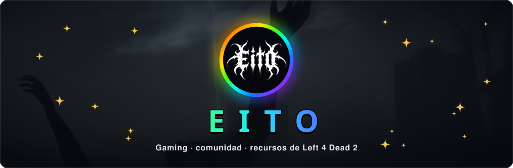
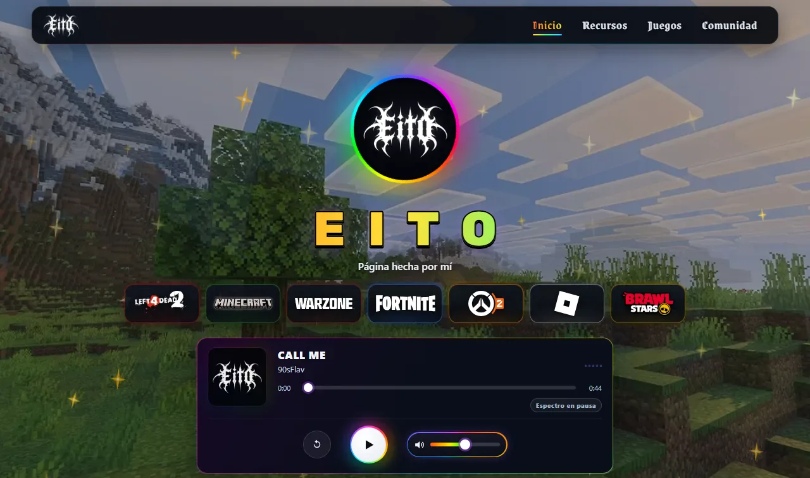
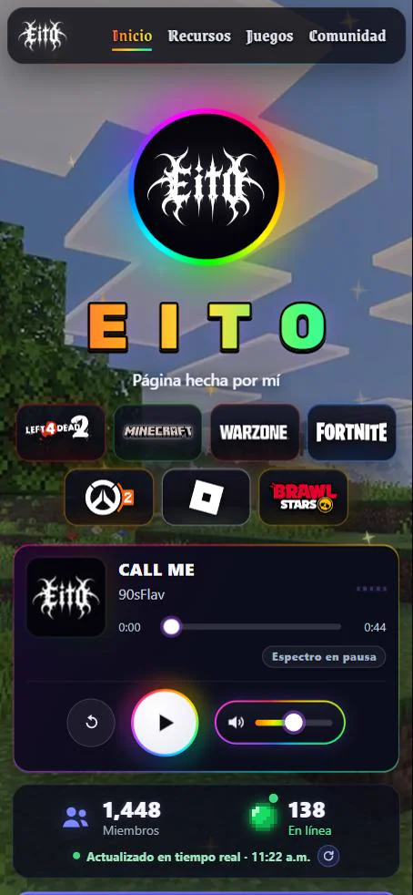

<div align="center">

<a href="https://eito-tv.github.io/"></a>

<br>

[](https://eito-tv.github.io/)
[](https://discord.gg/ReUtMYvgrx)
[](#-cómo-está-hecha)
[](#-seguridad-y-privacidad)

**Mi página personal: mis redes, mi comunidad de Discord, recursos de Left 4 Dead 2 y mis juegos.**

### [➜ Visitar eito-tv.github.io](https://eito-tv.github.io/)

</div>

<br>

<table>
<tr>
<td width="68%"></td>
<td width="32%"></td>
</tr>
<tr>
<td align="center"><sub>Computadora</sub></td>
<td align="center"><sub>Celular</sub></td>
</tr>
</table>

## ✦ Qué hay en la página

| Sección | Qué tiene |
|---|---|
| 🌈 **Perfil** | Logo con aro RGB que reacciona a la música y fondos de Minecraft, L4D2 y Warzone que van cambiando. |
| 🎵 **Reproductor propio** | Música con espectro en vivo. Nunca suena sola al abrir la página. |
| 💬 **Discord en vivo** | Miembros y gente en línea del servidor, leídos de la API pública de Discord. |
| 📱 **Redes** | TikTok, YouTube, Twitch, Steam, Xbox y más, con QR y botón para abrir en la app. |
| 🧟 **Recursos de L4D2** | Mis configs, como el [Autoexec sencillo](https://github.com/eito-tv/Autoexec-sencillon). |
| 🎮 **Mis juegos** | Fichas de cada juego con mi perfil o mi nombre para copiar. |

## ✦ Cómo está hecha

- **HTML, CSS y JavaScript puro.** No hay que compilar nada: GitHub Pages publica la rama `main` tal cual.
- **Todo se edita en un archivo:** [`js/config.js`](js/config.js) tiene los enlaces, fondos, música, juegos y perfiles.
- **Sin servicios externos:** los QR se generan en el navegador y las fuentes, imágenes y audio vienen de este mismo repo.

```
index.html          estructura de la página
css/                estilos, animaciones y versión para celular
js/config.js        ⭐ lo que cambias normalmente
js/*.js             funcionamiento (no hace falta tocarlo)
assets/             imágenes, logos, fondos, audio y fuentes
scripts/            actualizador de cifras de redes (opcional)
```

<sub>La guía completa de cambios está en [`LEEME.txt`](LEEME.txt).</sub>

## ✦ Seguridad y privacidad

- **Sin rastreadores, anuncios ni cookies.**
- **Política de seguridad (CSP):** la página solo puede cargar sus propios archivos y conectarse a la API pública de Discord. Si alguien intentara inyectar un script externo, el navegador lo bloquea.
- **Las claves nunca van en el código.** Las de YouTube, Twitch, Steam y demás se guardan en *Settings → Secrets* del repo.

<br>

<div align="center">

Hecha por **EITO** · [Discord](https://discord.gg/ReUtMYvgrx) · [YouTube](https://www.youtube.com/@eito_ttv) · [TikTok](https://www.tiktok.com/@eito_mvp) · [Twitch](https://www.twitch.tv/eito_ttv)

<sub>Los logotipos de juegos y plataformas pertenecen a sus respectivos dueños.</sub>

</div>
